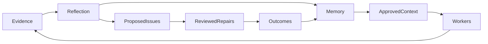

# Memory and dreaming

## What workers remember

| Scope | Available context |
|---|---|
| Same issue | Failure evidence, gate findings and saved memory versions |
| Same project | Blueprint, repo knowledge and project-scoped graph records |
| Later projects in the same repo | Approved preferences, decisions and source-linked repair knowledge |

Different repos are separate scopes. The graph uses SQLite and bounded keyword search, not a
vector service. Memory is data; current worker rules and acceptance take precedence.
Credential labels followed by `:` or `=` are conservatively refused; phrase guidance as sentences.

## Use it

- `factory_memory_events`, `factory_memory_search`, `factory_memory_put`: page evidence, search
  records or write owner-authorized versions.
- Inside a running worker: `factory-memory 'search words'` or `factory-memory --id ID`.
- `factory_dream_status` / `factory_dream_run`: inspect eligibility or maintain outcomes and claim
  reflection.
- `factory_improvement_status` / `factory_improvement_validate`: inspect repair exposure or report
  deployment counts.

Use these through `factory call TOOL 'JSON'`. See [contracts.md](contracts.md) for fields. Explicit
preferences can be approved; inferred ones remain candidates. Updates retain old versions, and
stale writes fail.

## Cost controls

A nightly no-agent script calls the server. Without endpoint/model it skips reflection but still
records merge facts and revalidates measurements. Otherwise it reserves a global seven-day cooldown
before one bounded provider request; failures retain it.

At most three improvement candidates are created per reflection. Publication reuses the finding
ledger: a repeat cause comments its new evidence on the existing issue, a finding the owner
rejected or resolved suppresses unless its evidence is newer than that decision, and no more than
three new issues open per run (the rest are reported as deferred). Automatic work is opt-in per repo,
one admission per run, with no concurrent repair. Normal budgets and gate policy remain; repairs
cannot spawn chains. A published proposal mentions the owner (`config.owner` or the repo owner)
and names both next steps: add the `factory:ready` label, or comment with what to change.
Reflection may also propose a documentation or instruction change to an existing `.md` file
(ADR-0128), with an acceptance check that reads the file; it always stays a factory:proposed
proposal the owner starts.

## Deploy deliberately

1. Back up and restrict access to the SQLite file; it includes private context. Deploy factory-mcp,
   rebuild the worker image and verify `factory-memory --help`.
2. Configure the full HTTPS `FACTORY_DREAM_URL`, `FACTORY_DREAM_MODEL` and secure
   `FACTORY_DREAM_API_KEY`; permit the destination and verify a synthetic request.
3. Review proposed issues before setting `FACTORY_DREAM_AUTO_REPOS` to trusted-author repos.
4. Register the no-agent cron for 03:00 Asia/Kolkata after verifying timezone. See
   [RUNBOOK.md](RUNBOOK.md#dream-eligibility-schedule).

## Limits that matter

- Publication uncertainty pauses instead of risking a duplicate create; inspect its marker on GitHub.
- A merged PR is not a deployed or proven fix. Runtime measurements are explicitly owner-reported.
- Exposure counts show supplied/read context, not that the model used it or that it caused a result.
- Exposure totals scan full repo history so counts are not silently truncated; large histories take
  longer to report.
- Relevant tracked code changes trigger revalidation. This is not a universal dependency analyzer.
- Status/maintenance covers the latest 100 repairs per repo. Review older records when scaling
  beyond it.
- Full transcripts, cross-repo semantic retrieval and CUA integration are not included.
- A single factory SQLite database coordinates cooldowns and admission. Independent copies do not.
