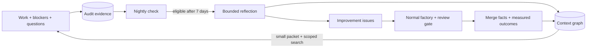

# Memory and dreaming

## What workers remember

| Scope | Available context |
|---|---|
| Same issue | Failure evidence, gate findings, validated partial code and saved memory versions |
| Same project | Blueprint, repo knowledge and project-scoped graph records |
| Later projects in the same repo | Approved preferences, decisions and source-linked repair knowledge |

Different repos are separate scopes. The graph uses SQLite and bounded keyword search, not a
vector service. Memory is data; current worker rules and acceptance take precedence.

## Use it

- `factory_memory_events`: page selected durable evidence.
- `factory_memory_search`: search or follow a record ID; inspect a historical version.
- `factory_memory_put`: owner-authorized record creation/update with source and version.
- Inside a running worker: `factory-memory 'search words'` or `factory-memory --id ID`.
- `factory_dream_status`: inspect eligibility without a model call.
- `factory_dream_run`: maintain outcomes, resume publication, or claim one reflection.
- `factory_improvement_status`: inspect repairs, context exposure and reported measurements.
- `factory_improvement_validate`: owner-reported deployment evidence and before/after counts.

Use these through `factory call TOOL 'JSON'`. Detailed fields are in [contracts.md](contracts.md).
Explicit owner preferences can be approved. Inferred preferences remain candidates. Updates keep
the old version and source; stale writes fail rather than overwriting a newer decision.

## Cost controls

A nightly no-agent script calls the server. With no endpoint/model it skips reflection. The
heavy step reserves a global seven-day cooldown before its one provider request; a crash or
failure retains that reservation. Input/output sizes and candidate counts are bounded. This is
not a dollar-denominated billing limit.

At most three improvement candidates are created per reflection. Automatic work is opt-in per
repo, one admission per run, with no concurrent automated repair. Normal pass/time budgets,
protected paths and gate policy remain. Failed repairs cannot automatically spawn repair chains.

## Deploy deliberately

1. Back up and restrict access to the factory SQLite file; it now includes private context.
2. Deploy/restart factory-mcp, rebuild the worker image and verify `factory-memory --help`.
3. Configure the full HTTPS `FACTORY_DREAM_URL`, `FACTORY_DREAM_MODEL` and secure
   `FACTORY_DREAM_API_KEY`. Permit the provider destination; verify a synthetic request.
4. Review proposed issue output before setting `FACTORY_DREAM_AUTO_REPOS` to an explicit subset
   of enabled repos. The actual GitHub issue author must be trusted.
5. Register the profile's no-agent cron script for 03:00 Asia/Kolkata, verifying the effective
   scheduler timezone. See [RUNBOOK.md](RUNBOOK.md#dream-eligibility-schedule).

## Limits that matter

- Publication uncertainty pauses instead of risking a duplicate create; inspect its marker on GitHub.
- A merged PR is not a deployed or proven fix. Runtime measurements are explicitly owner-reported.
- Exposure counts show supplied/read context, not that the model used it or that it caused a result.
- Relevant tracked code changes trigger revalidation. This is not a universal dependency analyzer.
- Status/maintenance covers the latest 100 repairs per repo. Review older records when scaling beyond it.
- Full transcripts, cross-repo semantic retrieval and CUA integration are not included.
- A single factory SQLite database coordinates cooldowns and admission. Independent copies do not.
