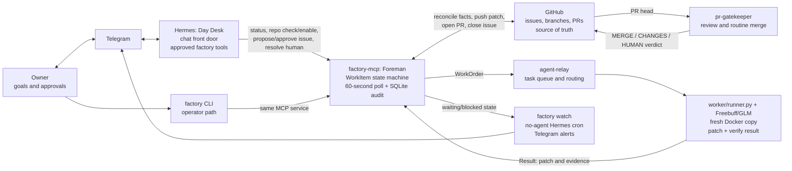
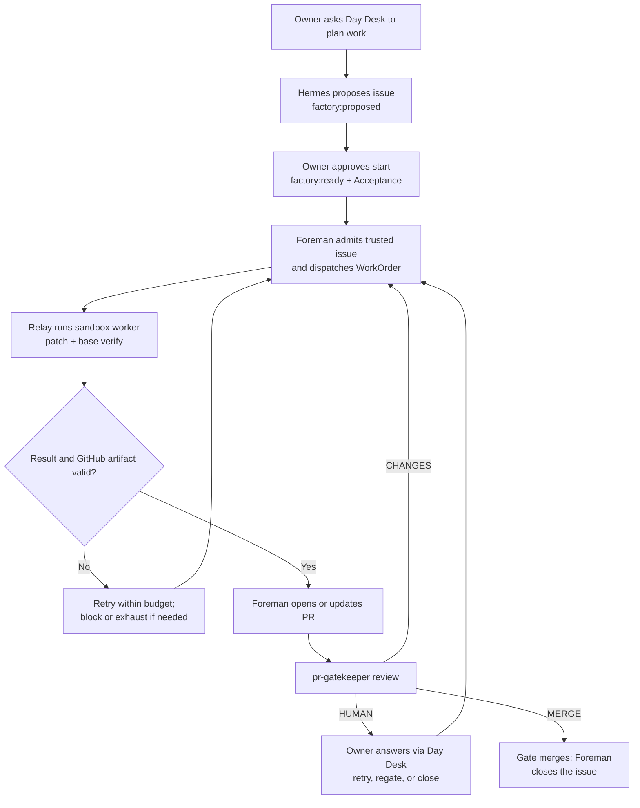

# Software factory: visual guide and setup

A person gives the factory a small, checkable GitHub issue. The factory sends it to a coding worker, checks the returned patch, opens a pull request, and follows review until the PR merges or a person must intervene. For example, an issue can request a field in `/healthz` and name the test that proves it.

## Who does what



Hermes is the **main human control surface**: the owner speaks to Day Desk in Telegram, and Day Desk calls only the factory tools listed in its profile. A write tool waits for the owner's approval; the approval times out after 15 minutes. Day Desk has no shell, file, browser, computer, or delegation tools. The `factory` CLI is a second operator path to the same MCP service. See [Hermes profile](../tenant/hermes/config.yaml) and [its skill](../tenant/hermes/skills/software-factory/SKILL.md).

`factory-mcp` is the **deterministic controller**. It owns each WorkItem's state, legal transitions, leases, side effects, and background ticks. This split lets Hermes be the owner's primary interface without allowing a model to decide a merge or bypass a guard. Hermes does not call `factory_tick` or `factory_intake`; the Foreman polls and rebuilds from GitHub itself. [Architecture](architecture.md) and [ADR-0013](decisions.md) explain the boundary.

If “main control plane” means that Hermes itself should own scheduling, WorkItem state, or transition decisions, the current implementation does **not** do that. It would require a deliberate architecture change; the merged Hermes work makes Day Desk the primary *human-facing* control plane.

The worker has a fresh container copy of the target repo, its model credential, and no GitHub credential or remote. It returns a patch after running the repo's `verify` command. `factory-mcp` validates protected paths and size, pushes `factory/<issue>`, and opens or updates the PR. pr-gatekeeper is the sole routine merger. GitHub's issue, PR, head SHA, check run, and verdict remain the durable facts; SQLite records work and audit history.

## One issue through the line



One deliverable issue maps to one branch and one PR. Keep it within 600 changed lines and 20 files. A WorkItem gets four worker passes by default, each with a 20-minute ceiling. Two consecutive failed attempts block it; no gate verdict for two hours sends it to a person. These are current operating defaults; check [RUNBOOK](RUNBOOK.md) for the recovery commands.

## Set up the factory on macOS

1. **Prepare the base services.** Install Python 3, Docker or OrbStack, `gh` and authenticate it, and have an agent-relay checkout at `~/.local/share/agent-relay` (or set `AGENT_RELAY_DIR`). Keep a clean deployment checkout at `~/.local/share/software-factory`. Sign in to Freebuff on the host so `~/.config/manicode/credentials.json` exists. Configure `freebuff-factory` in `~/.config/agent-relay/agents.json`; its command runs the **deployment checkout's** `worker/runner.py -- python3 /usr/local/bin/factory-freebuff`. The worker ID must match `FACTORY_WORKERS`.
2. **Build the sandbox and test dependencies.** From the deployment checkout, run `docker build -t factory-worker:latest worker/` and `python3 -m pip install -r requirements.txt`. The factory runtime itself uses the Python standard library; the pinned packages support tests.
3. **Configure factory-mcp.** Create `~/.config/factory-mcp/env` with `FACTORY_WORKERS=freebuff-factory:local`, `FACTORY_CHECKOUT_ROOT=<absolute path for worker checkouts>`, and optionally `FACTORY_REPOS=owner/repo` for initial allowlisting. Put `FACTORY_MCP_TOKEN=<random secret>` in `~/.config/factory-mcp/secrets` and set that file to mode 600. `factory serve` uses `gh auth token` unless `FACTORY_GITHUB_TOKEN` is set in secrets. The default MCP URL is `http://127.0.0.1:43125/mcp`; the relay defaults to port 43124. The relay writes its API token to `~/.config/agent-relay/token` on first start; factory-mcp reads it unless `AGENT_RELAY_TOKEN` overrides it. See the [configuration table](../README.md#run-factory-mcp).
4. **Install the services.** From the deployment checkout run `scripts/install-services.sh`, ensure `~/.local/bin` is on `PATH`, then run `factory start`. This installs launchd services for agent-relay and factory-mcp. Use `factory logs` if the controller does not start. There is no OpenBot, local TLS certificate, hosts entry, or `install-tenant.sh` step on current `main`.
5. **Enable a target repo.** It needs pr-gatekeeper with a working workflow and `.github/pr-gatekeeper.json` `verify` command, plus an `AGENTS.md` carrying the standard from [templates/AGENTS.md](../templates/AGENTS.md). That file is protected, so a person merges its setup PR. Run `factory add-repo owner/repo`; it reports missing requirements before enabling the repo, then creates a checkout and factory labels and records it in `~/.config/factory-mcp/repos.json`. This does not need a service restart.
6. **Prove the base path.** Run `python3 -m unittest discover -s tests -p 'test_*.py'`. Then run `python3 scripts/rehearsal.py <agent-relay-checkout>` and again with `--lose-store`; both should print `REHEARSAL PASSED`. Create a small issue with an `## Acceptance` section and `- <claim> — done when: <check>` bullets. Use `factory status` to follow it.

## Make Hermes the front door

The repo packages Day Desk's Hermes profile; it does not install the Hermes runtime, create a Telegram bot, or choose a model for you. With the Hermes CLI and Telegram bot ready, follow these commands from the [runbook](RUNBOOK.md):

### Hermes features to configure

| Hermes feature | Required Day Desk setting | Purpose |
|---|---|---|
| Profile and skill | Install `tenant/hermes/`; use the supplied `SOUL.md`, `config.yaml`, and `software-factory` skill | Gives the one owner-facing agent its reviewed instructions and tool workflow. |
| Model | Run `hermes -p day-desk model` and choose an available ChatGPT or Codex-backed model | Powers planning, explanations, and conversation; the model does not run the WorkItem state machine. |
| Telegram gateway | Set `TELEGRAM_BOT_TOKEN` and `TELEGRAM_ALLOWED_USERS` in the profile `.env`; run `gateway setup` and `gateway install` | Restricts chat to the owner and starts Day Desk at login. |
| MCP connection | Set `FACTORY_MCP_TOKEN` in the profile `.env`; keep the profile URL at `http://127.0.0.1:43125/mcp` unless `FACTORY_PORT` changes | Connects Day Desk to the local Foreman through an authenticated endpoint. |
| Tool allowlist | Keep `factory_status`, `factory_repo_check`, `factory_add_repo`, `factory_approve_issue`, `factory_propose_issue`, and `factory_resolve_human` | Gives Day Desk the owner-facing actions. `factory_tick` and `factory_intake` stay out because the Foreman polls on its own. |
| Write approvals | Keep MCP `trust: untrusted` and `approvals.timeout: 900` | Each write needs an explicit Telegram approval; silence for 15 minutes declines it. |
| Tool restrictions | Keep `terminal`, `code_execution`, `file`, `browser`, `computer_use`, and `delegation` disabled | Prevents Day Desk from using owner-level tools outside the reviewed factory interface. |
| No-agent cron | Run `factory watch` every 5 minutes with `--no-agent --deliver telegram`; keep `cron.mirror_delivery: true` | Sends escalation alerts without a model run and lets a reply reach Day Desk with the alert context. |
| Skill maintenance | Keep `curator.enabled: false`; run `hermes profile update day-desk` after factory deployment | Keeps the skill sourced from reviewed repo content. |

The profile [config](../tenant/hermes/config.yaml), [distribution manifest](../tenant/hermes/distribution.yaml), and [SOUL](../tenant/hermes/SOUL.md) contain these settings. The only secrets to place in the profile `.env` are the factory bearer token, Telegram bot token, and allowed user ID; keep that file private.

```bash
hermes profile install /absolute/path/to/software-factory/tenant/hermes
cp ~/.hermes/profiles/day-desk/.env.EXAMPLE ~/.hermes/profiles/day-desk/.env
# In that .env, set FACTORY_MCP_TOKEN, TELEGRAM_BOT_TOKEN, TELEGRAM_ALLOWED_USERS.
hermes -p day-desk model
hermes -p day-desk gateway setup
hermes -p day-desk gateway install
mkdir -p ~/.hermes/profiles/day-desk/scripts
printf '#!/usr/bin/env bash\nexport PATH="/opt/homebrew/bin:/usr/local/bin:$PATH"\nexec "$HOME/.local/bin/factory" watch\n' > ~/.hermes/profiles/day-desk/scripts/factory-watch.sh
hermes -p day-desk cron create "every 5m" --no-agent --script factory-watch.sh --deliver telegram --name factory-watch
```

The cron runs `factory watch` without an agent and sends new waiting/blocked alerts to Telegram. Reply to an alert to work through its escalation with Day Desk. After deploying a factory update, run `hermes profile update day-desk` to pick up the reviewed profile and skill changes.

Check the integration in Telegram: ask "what needs me?", check a repo that is missing the gate, approve a ready repo and an issue, and confirm a worker starts. Ask Day Desk to run `ls` or read its `.env`; it must have no tool to do either. Confirm a watch alert arrives and that a reply can resolve an escalation after approval. The runbook says to stop the gateway if the disabled tools are available.

## Which copy is running?

The separate checkout at `~/.local/share/software-factory` runs the installed service; updating another working tree does not deploy it. Run `factory update` from the deployment checkout to fast-forward, test, and restart that service, then update the Day Desk profile. The [runbook's deployment section](RUNBOOK.md#where-things-are) gives the installed paths.
